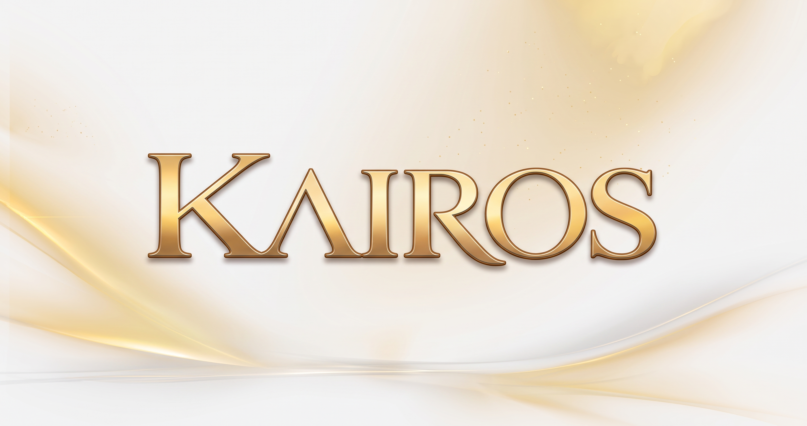

# Kairos Model Family

### Specialized AI models for cybersecurity, software engineering, modernization, decision-making, and lightweight inference.

  
  
  
  

---

## Overview

**Kairos** is a family of specialized AI models designed to solve practical problems with a focused approach instead of relying only on large, general-purpose systems.

These models are built around the idea that, in many scenarios, **a well-adapted model trained on curated domain-specific data can outperform more generic models on targeted tasks**.

The Kairos ecosystem currently covers:

- **Cybersecurity**
- **Software Engineering**
- **Legacy Modernization**
- **Structured Decision-Making**
- **Lightweight / low-resource inference**

---

## Core Philosophy

- **Domain specialization over generic breadth**
- **Curated data over raw scale**
- **Practical deployment over theoretical size**
- **Efficient fine-tuning over expensive infrastructure**
- **Local and accessible experimentation**

Much of the Kairos experimentation and adapter training process is designed around **accessible consumer hardware**, including environments such as an **RTX 3060 12GB VRAM**, using workflows supported by tools like **Sytra Studio** and **Unsloth Studio**.

---

## Model Lineup

> Ordered from **largest to smallest**.

<table>
  <thead>
    <tr>
      <th>Model</th>
      <th>Version</th>
      <th>Size</th>
      <th>Primary Objective</th>
      <th>Link</th>
    </tr>
  </thead>
  <tbody>
    <tr>
      <td><strong>Kairos Sophia</strong></td>
      <td>1.0</td>
      <td>27B</td>
      <td>Frontier software engineering, advanced reasoning, and enterprise-grade complex problem solving.</td>
      <td><a href="https://huggingface.co/Walkowicz/kairos-sophia-1.0-27B">Hugging Face</a></td>
    </tr>
    <tr>
      <td><strong>Kairos Sophron</strong></td>
      <td>1.0</td>
      <td>14B</td>
      <td>Software engineering, architecture, maintainability, clean code, and technical problem solving.</td>
      <td><a href="https://huggingface.co/Walkowicz/kairos-sophron-1.0-14B">Hugging Face</a></td>
    </tr>
    <tr>
      <td><strong>Kairos Sotos</strong></td>
      <td>1.0</td>
      <td>14B</td>
      <td>Cybersecurity, AppSec, SOC workflows, incident response, privacy, and compliance assistance.</td>
      <td><a href="https://huggingface.co/Walkowicz/kairos-sotos-1.0-14B">Hugging Face</a></td>
    </tr>
    <tr>
      <td><strong>Kairos Sophia</strong></td>
      <td>2.0</td>
      <td>9B</td>
      <td>Efficient next-generation frontier model for software engineering, frontend, and structured problem solving under more practical hardware constraints.</td>
      <td><a href="https://huggingface.co/Walkowicz/kairos-sophia-2.0-9B">Hugging Face</a></td>
    </tr>
    <tr>
      <td><strong>Kairos Sophron</strong></td>
      <td>2.0</td>
      <td>9B</td>
      <td>Modern software engineering, coding quality, architecture refinement, and realistic development workflows.</td>
      <td><a href="https://huggingface.co/Walkowicz/kairos-sophron-2.0-9B">Hugging Face</a></td>
    </tr>
    <tr>
      <td><strong>Kairos Sotos</strong></td>
      <td>2.0</td>
      <td>4B</td>
      <td>Compact cybersecurity-focused model optimized for practical security workflows with high efficiency.</td>
      <td><a href="https://huggingface.co/Walkowicz/kairos-sotos-2.0-4B">Hugging Face</a></td>
    </tr>
    <tr>
      <td><strong>Kairos Phronesis</strong></td>
      <td>1.0</td>
      <td>4B</td>
      <td>Structured decision-making, reasoning support, verification-oriented tasks, and analytical workflows.</td>
      <td><a href="https://huggingface.co/Walkowicz/kairos-phronesis-1.0-4B">Hugging Face</a></td>
    </tr>
    <tr>
      <td><strong>Kairos Phronesis Mini</strong></td>
      <td>1.0</td>
      <td>1.5B</td>
      <td>Smaller reasoning and decision support model for lighter deployments.</td>
      <td><a href="https://huggingface.co/Walkowicz/kairos-phronesis-mini-1.0">Hugging Face</a></td>
    </tr>
    <tr>
      <td><strong>Kairos Phronesis Nano</strong></td>
      <td>1.0</td>
      <td>0.5B</td>
      <td>Ultra-light structured reasoning model for constrained environments and experimentation.</td>
      <td><a href="https://huggingface.co/Walkowicz/kairos-phronesis-nano-1.0">Hugging Face</a></td>
    </tr>
    <tr>
      <td><strong>Kairos PI Large</strong></td>
      <td>1.0</td>
      <td>395M</td>
      <td>Lightweight decision model for low-latency tasks and compact inference scenarios.</td>
      <td><a href="https://huggingface.co/Walkowicz/kairos-pi-large-1.0">Hugging Face</a></td>
    </tr>
    <tr>
      <td><strong>Kairos PI Low</strong></td>
      <td>1.0</td>
      <td>149M</td>
      <td>Minimal-footprint decision model for highly constrained or edge-like environments.</td>
      <td><a href="https://huggingface.co/Walkowicz/kairos-pi-low-1.0">Hugging Face</a></td>
    </tr>
  </tbody>
</table>

---

## Family Structure

### Kairos Sophia
Focused on broader and more advanced software intelligence tasks, combining stronger reasoning, engineering support, and more ambitious problem-solving capabilities.

### Kairos Sophron
Focused on **software engineering and architecture**, including code understanding, development workflows, refactoring, modernization logic, and maintainability.

### Kairos Sotos
Focused on **cybersecurity**, including application security, vulnerability reasoning, SOC-related workflows, privacy regulations, and secure development practices.

### Kairos Phronesis
Focused on **reasoning and structured decision-making**, aiming to support analytical workflows that require consistency and controlled logic.

### Kairos PI
Focused on **small decision-oriented models** that can run with very low computational requirements.

---

## Why Kairos?

Kairos is built on a practical belief:

> **In many real-world scenarios, a smaller specialized model with better curated data can be more useful than a much larger general-purpose model.**

Instead of chasing scale alone, the Kairos family explores:

- Better alignment to real-world domains
- More efficient fine-tuning workflows
- Practical inference on affordable hardware
- Focused model behavior
- Reproducible experimentation

---

## Training Approach

The Kairos workflow heavily values:

- **AI-assisted dataset research and curation**
- **Fine-tuning with structured processes**
- **Adapter-based training approaches such as LoRA / QLoRA**
- **Repeatable local experimentation**
- **Deployment realism**

Tools and workflows involved in this process include:

- **Sytra Studio**
- **Unsloth Studio**
- **Gemini 3.8 Flash**
- **Local workflow skills for training pattern tracking and experiment standardization**

This approach helps maintain training consistency while making experimentation feasible even without high-end infrastructure.

---

## Hardware Accessibility

One of the goals behind Kairos is proving that meaningful experimentation is possible without extremely expensive hardware.

While large-scale training still benefits from powerful infrastructure, **fine-tuning and adaptation of capable models can already be done today on consumer-grade setups**, including GPUs such as:

- **RTX 3060 12GB**
- Similar mid-range GPUs
- Hybrid local/cloud workflows when needed

This opens the door for:

- Independent researchers
- Students
- Small teams
- Local AI builders
- Open experimentation environments

---

## Hugging Face Profile

You can explore the full Kairos family here:

### [Walkowicz on Hugging Face](https://huggingface.co/Walkowicz)

---

## Notes

- Model availability depends on what is currently published in the public Hugging Face profile.
- Future generations may expand or refine the Kairos family structure.
- This repository README serves as a central overview of the currently published model lineup.

---

## License / Usage

Please check each model page individually on Hugging Face for its specific license, intended use, and usage limitations.

---

### If you find Kairos interesting, consider following the project on Hugging Face.

